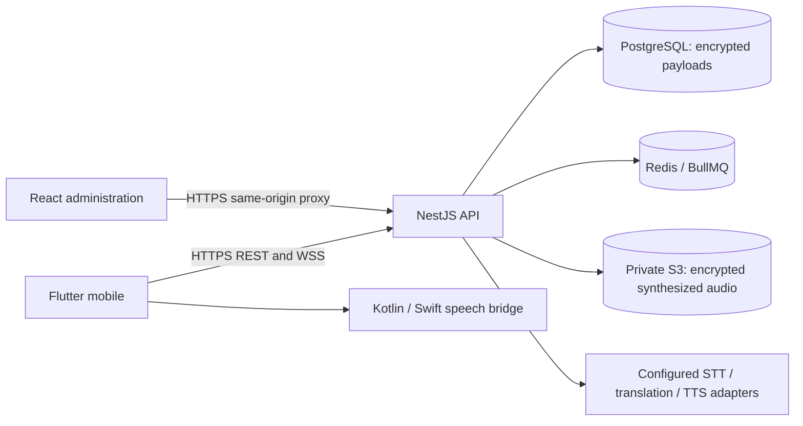

# Architecture and implementation boundary

Mine2YourLingo is a Flutter client, a Vite/React administration client and a NestJS modular API. The current increment implements a runnable development system and deployment scaffolding. It is not approved for commercial launch. Live verification of the configured identity/AI/billing providers, push delivery, iOS compilation, physical-device receiving tests and operational validation remain release gates.

## Boundaries

The API is the authorization authority. Group roles control membership and broadcast permissions; sender/listener languages are user preferences, not role directions. Every audio retrieval checks the authenticated user, group membership, recipient language and retention state. A signed URL does not replace authorization. Provider API keys remain on the server.

The AI adapter contract separates transcription, translation and synthesis. Source-language passthrough is labelled as such. Missing translation providers produce a failure rather than an invented result. Translation reuse is scoped to the group, source/target languages, model/glossary version and voice settings. Distinct recipient languages drive fanout. External provider requests require explicitly confirmed versioned pricing. The server detects changed numeric tokens; this is a narrow check, not proof of translation quality, preserved units or safe instructions.

Native speech selects available platform voices and reports a playback lifecycle. Authorized server-generated audio can also play through bounded native downloads and platform media players. Completion means the native engine/player finished; it does not prove that a person heard or understood the message. Android accepts only voices marked as requiring no network and not flagged as uninstalled. iOS lists system voices; offline functionality must be measured on each device.

## Storage and scale

Prisma supplies PostgreSQL migrations and relational lookup fields. Sensitive entity payloads are AES-GCM encrypted by the application. The development fallback persists encrypted local state and must never be used for production. Database identifiers, group relationships and timing metadata remain outside encrypted payloads where needed for indexing.

The present store reads entity collections into memory and serializes modifications with a PostgreSQL advisory transaction lock. This preserves development transaction behavior but limits throughput and creates a scaling gate. Before a public pilot at scale, replace whole-state loading with scoped Prisma queries and record-level transactions, test concurrent quota reservations, and measure query latency and memory consumption. Do not horizontally scale the API based solely on container health.

Redis and BullMQ support the asynchronous processing path when configured. A queue worker, database transaction and external provider do not form one atomic transaction. Verify retry/idempotency behavior and orphan-audio cleanup under process termination. Audio retention is enforced at retrieval and cleanup boundaries; storage lifecycle rules are additional protection rather than the authorization layer.

## Receiving limitations

Android provides an explicitly started, visible `mediaPlayback` foreground service for already-delivered speech. It has a Stop notification action, audio-focus handling, route-disconnect cancellation, a 60-second idle timeout and 15-minute session maximum. It is not a native network receiver. The Dart realtime connection does not become a guaranteed background connection by starting this service. Force-stop, process death and reboot do not reactivate receiving.

iOS speech runs while the app is active and stops when it backgrounds. No PushKit, CallKit, VoIP entitlement, silent audio loop or background-audio mode is declared. Ordinary local notification fallback can be scheduled only if a message actually reaches the running app and notification permission was granted. Remote APNs/FCM delivery requires a separately configured push integration. This increment cannot promise remote notifications after suspension or termination.

Neither platform guarantees immediate emergency delivery. This product must not replace certified emergency communication.

See [the native contract](native-audio.md), [decisions](../decisions/README.md), [security](../security/README.md) and [release validation](../testing/README.md).
